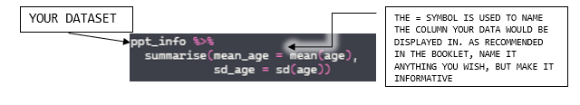
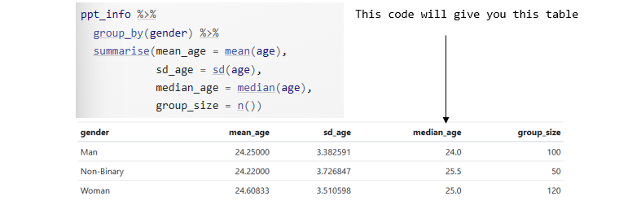
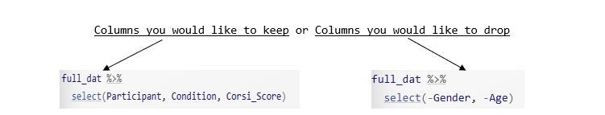

## What is Each Function for?

### Setting Up

```{r}
#| eval: false
install.packages('package_name')
```

This is typed in your console to download any desired packages.<br> -\> Remember to put the name of the package in quotes.

```{r}
#| eval: false
library(package_name)
```

Used this load a package that has the desired functions and datasets in it.<br> -\> You are telling R 'Make everything in this package available for me to use'.

```{r}
#| eval: false
read_csv(file = 'file_name')
```

Use this to import .csv datasets into R Studio. -\> Remember you can read in the datasets and asign them any name. For example:

```{r}
#| eval: false
data <- read_csv(file = 'file_name')
```

<br>

### Checking Your Data

```{r}
#| eval: false
summary('dataset_name')
```

Use this to display all descriptive statistics of the desired dataset in the Console pane.

```{r}
#| eval: false
str('dataset_name')
```

Use this to show the internal structure of a dataset, including variable types and example values.

- Some outputs in the Console Pane could be:
  - num = numeric
  - chr = character
  - int = integer
  - factor = categorical value

```{r}
#| eval: false
%>%
```

This is called a **pipe**, used to take an pbject and send it to the next function. -\> Read it as: 'Take this dataset and then carry out this function on it'.

```{r}
#| eval: false 
count('name_of_object')
```

Use this to count the number of observations of the desired object in the dataset. For example = number of participants or the number of people in each gender.

```{r}
#| eval: false
data %>%
  count()

or 

data %>%
  count(gender)
```

```{r}
#| eval: false
summarise() 
```

Use this to create a table with the summary statistics you need.



<br>

In R for summary statistics, there are a couple of functions, and the most common ones are:

| Function | Description |
|:-----------------------------------|:-----------------------------------|
| `mean(x)` | Calculates the mean of a numeric vector |
| `median(x)` | Finds the median of x |
| `max(x)` | Finds the maximum value in x |
| `min(x)` | Finds the minimum value in x. |
| `var(x)` | Computes the variance of x |
| `n()` | Computes the number of observations, similar to `count()` BUT used inside other functions like `summarise(n = n())` |
| `range(x)` | Displays the max and min value of the desired data |
| `sum(x)` | Calculates the sum of all values in x |
| `sd(x)` | Calculates standard deviation of x |

*Consulted with (Data Summaries with Dplyr, 2022)*

<br>

```{r}
#| eval: false
group_by()
```

Used this to compute summary statistics in your desired groups. R will select the specified column and divide the data into groups.

Example from the booklet:



<br>

### Data Transformation

```{r}
#| eval: false
inner_join(x = variable1,  #The name of the first table you want to join.
           y = variable2,  #The name of the second table you want to join.    
           by ='x')        #The name of the column the two tables have in common. 
```

Use this to make a new table from two datasets that have matching columns.

```{r}
#| eval: false
select()
```

Use this to create a new dataset with just the columns you need, plus reorder them and rename them at the same time. \* You have two options:



<br>

```{r}
#| eval: false
filter()
```
This function is used to pick which rows you want to keep based on one or more criteria. 
